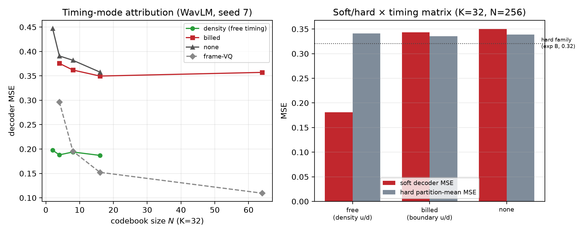
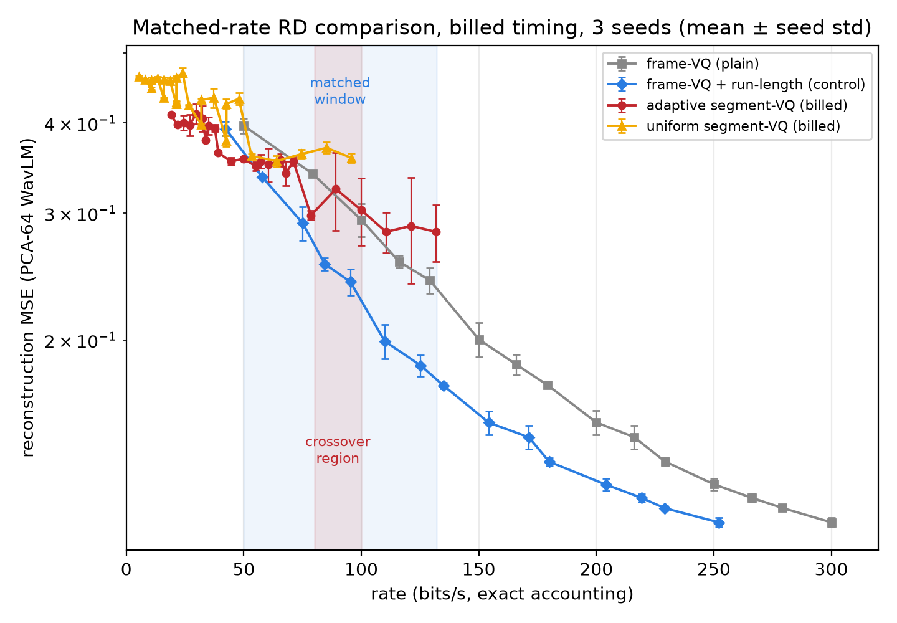

# Adaptive Temporal Segmentation of Speech: A Controlled Characterization on WavLM and Mel Features

**Abstract**

Vision's query–mask decompositions motivate whether a learned monotonic temporal partition can represent speech more efficiently than per-frame codes. We characterize a differentiable density-warp segmenter on Nepali speech against uniform, random, and dynamic-programming (DP) partitions, with decision rules and bit accounting that bills boundary side information and decoder-side timing. Three findings define its operating envelope. First, un-billed feature-derived timing channels substantially inflate the apparent low-rate segment advantage; with timing billed and rates matched (three seeds), billed segment-VQ beats frame-VQ by 10–12% at 50–79 b/s, but a run-length-coded frame baseline — variable-rate allocation without learned segmentation — is ahead or at parity at ≥75 b/s, so no demonstrated rate-distortion advantage for learned segmentation remains: the low-rate win is at least partly attributable to variable-rate allocation, and the 50–58 b/s region is unresolved (the baseline's discrete points are not exactly rate-matched). Second, learned boundaries at K=32 are a genuine partition distinct from DP (~10.5 frames from DP; a uniform grid is 9.8 frames) yet metric-equivalent within a pre-specified margin, with weak phone structure absent at K=16; segment vectors encode duration (incremental R² ≈ +0.53 beyond phone class). Third, the warm-started recipe is robust but supervised: on real speech, results describe identifiability after DP initialization, not unsupervised discovery. Scope: WavLM features, billed timing, fixed-length index billing, ideal enumerative boundary charges, and the DP-warm-started recipe; a mel matched-rate window and a mel run-length control were not run. We will release at [REPO-URL] the harness — monotonic partitions, a DP oracle, the gap-closed metric, billing conventions — for future segmentation work.

**Keywords**: temporal segmentation, speech representation, WavLM features, rate-distortion, adaptive partitioning, query-mask decomposition

---

## 1. Introduction

### 1.1 Motivation

Query-based mask architectures have reshaped computer vision. MaskFormer and Mask2Former [1,2] replace dense per-pixel prediction with a set of learned queries, each selecting a mask and a descriptor; SAM [3] adds promptable segmentation. Speech generation faces a structurally analogous problem: how to represent temporal organization — phonetic, prosodic, acoustic — with fewer degrees of freedom than per-frame features, without binding timing to text tokens through explicit duration prediction [4,5]. Recent work has even questioned whether alignment is needed at all [6].

The analogy is motivational only: the trained mechanism reduces to a near-hard segmenter (88.5% of soft-mask mass inside the corresponding hard segment, §4.6), so the "masks as a separate object" hypothesis finds no support here.

This motivates a direct empirical question:

> Can a learned, monotonic temporal partition — the temporal analogue of a query-mask decomposition — represent speech with lower distortion than uniform partitions at a matched number of units, and do its boundaries carry structure beyond local acoustics?

### 1.2 What we test, and what we find

We pre-specified, before each experiment, the decision rules used to interpret it. The program has three stages.

**Stage 1 — mechanism validation (Experiment A, synthetic).** The density-warp parameterization recovers near-optimal boundaries once trained with a boundary-supervised warm start followed by unsupervised temperature annealing (condition-mean $G \ge 0.934$ with per-seed minimum 0.922; boundary F1@±1 condition means $\ge 0.941$, per-seed minimum 0.932). Two failures are part of this record: the first unsupervised pilot run *failed* (worse than uniform; gap-closed negative), and a controlled diagnostic identified both a warp-normalization bug and a degenerate-optimization problem that the warm-start-plus-anneal recipe fixes. A fixed-temperature control ($G = 0.274$) shows annealing is the active ingredient.

**Stage 2 — rate-distortion on real speech (Experiments B, B2, F, and the low-rate correction).** In the original rate bands (segment arms 30–81 b/s, frame arms 300–861 b/s) the ranges do not overlap, so no dominance claim is testable. Extending frame-VQ down to N ∈ {2,4,8,16} revealed that the curves actually cross: segment arms appeared to win below ~180 b/s (WavLM) and ~260 b/s (mel). A controlled attribution experiment (§4.8) then traced that apparent advantage to the decoder's phase/duration channels, which carry per-frame timing computed from the input features at zero charged bits. With the leak closed, billed segment-VQ retains a 10–12% advantage over *plain* frame-VQ at 50–79 b/s (3/3 seeds, §4.10); the run-length control and the calibrated conclusion are in §4.14. The durable finding is methodological: **RD comparisons of segmental vs. frame-level architectures must bill decoder-side timing, match rates, and include a variable-rate control, or they will substantially inflate the measured advantage.**

**Stage 3 — boundary interpretation (Experiments C, D, E, plus drift).** At K=32, learned boundaries align weakly with MAS phone edges (F1 0.442), beat matched controls (+0.044 over random@32, +0.015 over uniform@32), and tie the reconstruction-optimal DP on saturated alignment metrics. Direct measurement shows they are nonetheless a genuinely different partition: refinement moves ~7.9 frames beyond its step-300 DP warm start, ending ~10.5 frames from DP — farther than the warm start began. At K=16, matched-count controls show all comparisons are ties: no structure, and no active avoidance. Probe analysis finds no information-organization advantage over uniform, while DP probes better on phones and energy — largely expected, since DP minimizes within-segment variance. The one robust positive is a content–duration coupling (R² ≈ 0.72 across three seeds, norm-only control ≈ 0), a mechanism consequence rather than an advantage, with probe-protocol caveats noted in §5.4.

**Claims and scope.** We claim: the monotonic partition parameterization with exact guarantees; an RD characterization of this architecture versus per-frame codes on WavLM features under billed timing, matched rates, and a variable-rate control; and the accounting requirements that make such comparisons interpretable. We do not claim that adaptive or variable-rate tokenization is useless (prior systems with different objectives are existence proofs), nor that the conclusions transfer to mel features at matched rates (untested), other speakers, languages, or feature extractors. Rate figures use fixed-length index charges and ideal enumerative boundary costs (§3.5) — a convention that disfavors the segment arm (§5.4) — and the mechanistic readings in §4.5–§4.7 and §5.2 are interpretations, not tested mechanisms.

### 1.3 Reusable artifacts

Independent of the headline, we will release at [REPO-URL]: (1) a differentiable, ordered, monotonic partition parameterization with exact partition guarantees; (2) an explicit rate-accounting convention (segment bits + boundary side information, with bit-matched baselines), together with two requirements that this documentation explains and tests: rate-overlap verification and an audit for decoder-side timing channels; (3) a DP reconstruction-optimal segmentation oracle and the gap-closed metric $G$; (4) causal boundary-perturbation protocols with matched reconstruction families; (5) the follow-up experiments themselves (matched-count K=16 controls, warm-start drift instrumentation, low-rate sweeps, u/d attribution runs, matched-rate multi-seed RD sweeps, and the run-length control) as reusable templates. Each ingredient is individually standard; the contribution is the controlled harness, the audit methods, and the demonstration that they change conclusions.

---

## 2. Background and Related Work

### 2.1 Segmentation in computer vision

MaskFormer [1] predicts masks and labels via Hungarian matching; Mask2Former [2] adds masked attention for universal segmentation; SAM [3] adds promptability. The query–mask analogy is motivational only: the trained speech mechanism reduces to a near-hard segmenter (88.5% hard mass, §4.6), so the “masks as a separate object” hypothesis is unsupported here. The abstractions we test for transfer to time are: set prediction over regions, latent queries selecting regions via masks, and promptable control. Our construction imposes one additional constraint vision does not need: **monotonicity** — speech is sequential, so segment $k$ must precede segment $k+1$.

### 2.2 Temporal structure in speech synthesis

FastSpeech2 [4] predicts per-phoneme durations; Glow-TTS [5] learns monotonic alignment via MAS; EATS [7] uses soft-DTW. F5-TTS [6] removes duration models entirely and reports robustness problems in implicit alignment. Our partition construction is a generalization of these alignments in one specific sense: boundaries are free variables optimized for reconstruction rather than for text agreement.

### 2.3 Unsupervised and variable-rate speech tokenization

Sylber [8] distills self-supervised syllabic structure, reaching ~4.27 tokens/s. SyllableLM [9] learns coarse syllable-like units for speech language models. VARSTok [10] allocates tokens by temporal-aware density-peak clustering with implicit duration coding and reports gains over fixed-rate baselines. SlowAEs [11] learn slowly-varying event representations with variable bitrate. SCPC [12] trains a differentiable boundary detector jointly with frame- and segment-level encoders. FlexiCodec [13] merges semantically similar frames for dynamic low-frame-rate coding. CodecSlime [14] performs dynamic-frame-rate compression through DP-based temporal redundancy removal.

Recent work has also begun studying the interpretation of dynamic-rate codec boundaries directly. "Interpreting and Evaluating Dynamic-Rate Speech Codec Boundaries" [15] compares boundary algorithms against uniform baselines and analyzes what dynamic-rate codec boundaries represent.

Two further families are adjacent. Query-based temporal compression appears in audio language models as Q-Former-style resamplers, which compress speech features into a fixed number of learned queries before an LM consumes them — the same set-of-queries abstraction without monotonicity or explicit rate accounting. Run-length-deduplicated discrete units (as in SlowAEs [11]) are the cheapest variable-rate baseline: quantize per frame, merge consecutive identical codes, and charge rate only for change points; §4.14 runs this control: at ≥75 b/s it is ahead of or at parity with the segment family, and it shows the remaining low-rate advantage is at least partly attributable to variable-rate allocation.

### 2.4 Positioning

These systems demonstrate that adaptive temporal unit discovery *works*; our evaluation targets a narrower claim that is not directly tested by these systems: whether a reconstruction-trained monotonic query-mask partition beats per-frame codes at matched rates *under accounting that bills boundary side information and decoder-side timing*. Our claim structure is deliberately narrow: (i) we do not claim adaptive segmentation is useless — VARSTok, Sylber and FlexiCodec are existence proofs to the contrary, with different objectives (TTS reconstruction quality, LM-friendly rates, ASR-guided merging); (ii) we do claim that in this controlled setting — frozen features, reconstruction objective, matched decoder architecture and latent dimensionality per transmitted token, explicit bit accounting — no demonstrated rate-distortion advantage for learned adaptive segmentation is observed under the controls of §4.14; learned boundaries carry no detectable structure beyond acoustic homogeneity (all but one statistic, §4.5); and (iii) the harness (bit accounting, rate-overlap checks, free-channel audits, DP oracle, gap-closed metric, causal tests) is offered so that future variable-rate tokenizers can be evaluated against the controls that made this result interpretable.

### 2.5 A note on decoder side information

The timing leak is a design flaw in this paper's own decoder, not a newly discovered phenomenon: the decoder's phase/duration channels (§3.3) were computed from the input features and were not charged in the bit accounting. Decoder side information of this kind must be transmitted, derived solely from transmitted information, or excluded from the claimed compression pathway; the accounting in §3.5 is written so that it is.

Formally, let $X$ be the input, $Y$ the transmitted representation, and $D(Y)$ the legitimate decoder. The reconstruction should satisfy $\hat{X} = D(Y)$ rather than $\hat{X} = D(Y, g(X))$, where $g(X)$ is any decoder-side information derived from $X$ without charge. The total rate is $R_{\text{total}} = R_{\text{token}} + R_{\text{boundary}} + R_{\text{timing}} + R_{\text{other}}$, where $R_{\text{timing}}$ is information supplied through decoder inputs that the bitrate accounting does not charge; billed accounting requires $R_{\text{decoder-only feature information}} = 0$.

We expect the requirement to be relevant to, but did not test it for: learned compression systems with auxiliary decoder inputs; neural codecs and learned image/video compression; variable-rate representations and adaptive sampling; retrieval/compression systems with side information; tokenizers and quantized representations.

VARSTok's explicit duration coding contrasts instructively: it intentionally embeds duration into the token representation and bills it as part of the rate, whereas our decoder supplied the same kind of timing through an unbilled channel. The methodological point is narrow — the accounting conventions needed to evaluate such architectures correctly — and it is demonstrated here on this paper's own architecture.

---

## 3. Method

### 3.1 Problem formulation

Let an utterance representation be $F \in \mathbb{R}^{T \times H}$ ($T$ frames, $H$ features). The model produces $K$ queries with temporal masks and latent vectors:

$$
\{(M_k, Z_k)\}_{k=1}^{K}, \quad M_k(t) \in [0,1], \qquad \hat{F} = D\Big(\textstyle\sum_k M_k(t) Z_k\Big)
$$

We impose **monotonic ordered masks**: speech is sequential, so the mask family must respect order. Independent sigmoid masks do not; a density-warp construction does.

### 3.2 Monotonic partition masks

We predict a per-frame boundary density $\rho_t = \rho_{\min} + \operatorname{softplus}(w^\top v_t)$, where $v$ is a small local encoder of $F$, and define the cumulative warped coordinate

$$
C(t) = K \, \frac{\operatorname{cumsum}(\rho)_t}{\operatorname{cumsum}(\rho)_T} \in [0, K]
$$

**Proposition (discrete form).** Let $S_t = \operatorname{cumsum}(\rho)_t$ over frame indices $t = 0, \dots, T$ and $C(t) = K S_t / S_T$. If $\rho_t > 0$ for all $t$, then $C$ is a strictly increasing sequence over the index set, and the first-crossing boundaries $b_k = \min\{t : C(t) \ge k\}$ (with $b_0 = 0$, $b_K = T$) satisfy $b_1 \le b_2 \le \dots \le b_{K-1}$, with strict inequality $b_{k+1} > b_k$ whenever $\max_t \big(C(t{+}1) - C(t)\big) < 1$.

*Proof.* $S_{t+1} - S_t = \rho_{t+1} > 0$, so $C$ is strictly increasing, and $C \in [0, K]$ since $S_T = \max_t S_t$. For the first-crossing rule, $\{t : C(t) \ge k{+}1\} \subseteq \{t : C(t) \ge k\}$, hence $b_{k+1} \ge b_k$. If every step of $C$ is smaller than 1, then $C(b_k) < k+1$ (because $C(b_k - 1) < k$ and $C(b_k) = C(b_k{-}1) + \Delta$ with $\Delta < 1$), so level $k{+}1$ is first reached strictly after $b_k$. ∎

No continuity or interpolation assumption is used; the argument lives entirely on the discrete index set. The implementation uses the nearest-level rule $b_k = \operatorname{argmin}_t |C(t) - k|$ (more robust for soft masks); for monotone $C$ its minimizer lies in $\{b_k - 1, b_k\}$, so it agrees with first crossing up to one frame and is non-decreasing in $k$, with degenerate equal-boundary cases (an empty segment) possible only in near-tie situations that the rate cost of unused segments discourages in practice.

**Note on the normalization.** An earlier draft (and the first pilot implementation) normalized by $K-1$, mapping the boundary coordinate to $[0,1]$; the corrected version, used in all reported results, scales to $[0,K]$ so that integer levels $1,\dots,K-1$ correspond to interior boundaries. Boundaries are $b_k = C^{-1}(k)$ with $b_0 = 0$ and $b_K = T$ by construction, and the soft masks are

$$
\sigma_k(t) = \sigma\Big(\frac{C(t) - k}{\tau}\Big), \qquad m_k(t) = \sigma_{k-1}(t) - \sigma_k(t)
$$

with fixed endpoints $\sigma_0 := 1$, $\sigma_K := 0$, giving $\sum_k m_k(t) = 1$ to numerical precision (partition error $\le 1.2 \times 10^{-7}$ throughout). The uniform baseline is the special case $\rho_t = $ const, so adaptive and uniform arms share every other component.

### 3.3 Segment representation and decoder

To prevent leakage through the pooled vectors, segments pool from a linear projection $PF_t$ rather than the context-rich encoder — a precaution that covers the segment vectors only; the $u/d$ channels added below are a separate path, and §4.8 shows they were effectively unbilled. Formally, $z_k = g\big(\sum_t m_k(t) PF_t / \sum_t m_k(t)\big)$ with small $d_z \in [16, 32]$. Because a piecewise-constant composition cannot represent intra-segment dynamics, the decoder input adds within-segment phase $u(t) = \operatorname{frac}(C(t))$ and active-segment length $\log d_k(t)$:

$$
h_t = \Big[ \textstyle\sum_k m_k(t) z_k \; ; \; u(t) \; ; \; \log d_k(t) \Big]
$$

This puts timing into $(u, d)$ rather than into $z_k$ — a design choice whose consequences dominate the quantized comparisons of §4.3 and §4.8: both channels are computed from the input features via the density field and carry per-frame timing that the bit accounting does not charge.

### 3.4 Objective and training recipe

Without VQ: $\mathcal{L} = \|F - \hat{F}\|^2$ plus small entropy regularization; mask temperature $\tau$ is annealed from 0.35 to 0.08. The recipe that works on synthetic data is **boundary-supervised warm start (800 steps) → remove supervision → anneal $\tau$ (1,200 steps)**. On real speech, all adaptive arms use **300 steps of DP boundary supervision** (the cached reconstruction-optimal partition as a warm-start target), then anneal for 1,700 steps. This warm start matters for interpretation and is discussed in §4.2.

### 3.5 Baselines and bit accounting

Adaptive boundaries carry side information: placing $K-1$ boundaries on a $T$-frame grid costs $\log_2 \binom{T}{K-1}$ bits. Our accounting charges this explicitly, and uses these baselines:

**Three notions of rate.** Our analysis distinguishes:

- **Representation rate** $R_{\text{token}}$: bits from codebook indices (or frame latents)
- **Boundary rate** $R_{\text{boundary}}$: bits required to communicate segmentation (the $\log_2 \binom{T}{K-1}$ term)
- **Side-channel rate** $R_{\text{timing}}$: information supplied through decoder inputs not in the transmitted message

The total rate is $R_{\text{total}} = R_{\text{token}} + R_{\text{boundary}} + R_{\text{timing}} + R_{\text{other}}$. Our decoder had $R_{\text{side-channel}} > 0$ even though the initial accounting treated it as $R_{\text{side-channel}} = 0$; the corrected convention charges every decoder input that is not a function of the transmitted message, so that $R_{\text{decoder-only feature information}} = 0$.

**Accounting precision.** The boundary cost $\log_2 \binom{T}{K-1}$ is an ideal combinatorial code length, not necessarily the exact transmitted bits. We report this ideal description length, acknowledging that actual implementations may achieve different code lengths through arithmetic coding or other entropy coding schemes. The distinction matters because the entire paper is about accounting correctness.

1. **Uniform** segmentation at $K$;
2. **Bit-matched uniform** at $K_u$, where $K_u$ solves $K_u \cdot d_z \cdot b = K \cdot d_z \cdot b + \log_2 \binom{T}{K-1}$;
3. **DP-optimal** piecewise-constant segmentation (O($KT^2$) exact oracle; lower bound for hard partitions);
4. **Random** boundary placement (chance control);
5. **Frame-level** latents (PCA or per-frame VQ) as the non-segmental alternative.

The headline within-family metric is the fraction of the DP gap closed,

$$
G = \frac{D_{\text{uniform}} - D_{\text{learned}}}{D_{\text{uniform}} - D_{\text{DP}}}
$$

"Adaptive beats uniform" is weak evidence by itself — uniform is a feasible solution to the optimal $K$-segmentation problem — so every within-family claim is stated against $G$ and the DP oracle.

**What our quantized comparison does and does not match.** In the VQ experiments (B2, F), each token costs $\log_2 N$ bits; segment arms emit $K$ tokens per utterance, frame arms emit $T$ tokens. The original codebook ranges put the arms at 4–14× different total bitrates, so we report exact bits/s for every point (§4.3, §4.7) and treat rate overlap as an experimental requirement, not a default. Two further accounting hazards, both discovered during this program and both repaired: (i) rate *overlap* is necessary but not sufficient — the decoder's u/d channels carry un-billed per-frame timing (§4.8), which must also be controlled before any cross-family RD comparison; and (ii) within-family comparisons (adaptive vs. uniform) are unaffected because both arms carry identical channels. In the *continuous* Experiment B, per-arm content bits are equalized by construction, and we identify the closest pair explicitly in §4.2.

### 3.6 Data and features

**Dataset:** Nepali FastSpeech2 corpus (4,530 utterances, 9.8 hours, 22.05 kHz, single speaker). Training/validation uses 1,300 utterances; the held-out test set is the first 48 test-split utterances for all analyses that reference alignments or caches (32 for the initial B run).

**Features:** frozen WavLM-base layer 6 (content-biased, 50 Hz, $H{=}768$), reduced to $H'{=}64$ by PCA fit on the training split only, cached as fp16. Experiment F uses native 80-dim log-mel at 86.13 Hz with per-dimension z-score standardization, no PCA.

**Alignments:** MAS phone durations from a trained FastSpeech2 checkpoint, extracted batch-wise via the project inference stack. These are the model's own learned durations, not human phoneme labels — a caveat that applies to every structural claim below.
---

## 4. Experiments

We conducted seven core experiments in sequence, with decision criteria specified in writing before each run, followed by replication, attribution, and control runs (matched-count K=16 controls, warm-start drift, low-rate sweeps, u/d attribution, the billed-timing arm, a codebook-collapse control, and the run-length control). Each section states its own final result; where an interim conclusion differed, the body keeps at most a one-sentence pointer, and the full history is in Appendix C.

**A note on scope.** All conclusions are about this architecture, under this accounting, on this data (one speaker, one language): we characterize, and do not claim universal negatives.

### 4.1 Experiment A: Mathematical sanity check (synthetic)

**Question:** does the density-warp segmenter recover known boundaries on synthetic piecewise-constant signals?

**Full record, including the failures.** The first unsupervised pilot (1,000 steps, reconstruction only) **failed**: learned MSE 0.695–0.828 vs. uniform 0.336–0.438, boundary MAE 59–66 frames, gap-closed negative in all three conditions. Diagnostics traced this to (i) a warp-normalization bug (coordinate mapped to [0,1] instead of [0,K]; fixed to the form in §3.2) and (ii) a degenerate optimization landscape for reconstruction-only training. The corrected recipe — oracle-parameterization test, then boundary-supervised warm start, then supervision removal with $\tau$ annealing — succeeds. A fixed-temperature control isolates annealing as the active ingredient ($G = 0.274$ vs. 0.962).

**Completion results** (warm start → anneal, 2 seeds per condition):

| Condition | noise_std | Uniform MSE | DP MSE | Learned MSE | Boundary MAE | F1@±1 | Gap closed G |
|---|---|---|---|---|---|---|---|
| clean K=4 | 0.05 | 0.3173 | 0.0024 | 0.0131 ± 0.0001 | 0.71 | 0.996 | 0.966 ± 0.000 |
| noisy K=4 | 0.30 | 0.4248 | 0.0872 | 0.1088 ± 0.0016 | 2.36 | 0.941 | 0.936 ± 0.005 |
| clean K=6 | 0.05 | 0.3423 | 0.0024 | 0.0246 ± 0.0014 | 0.75 | 0.951 | 0.935 ± 0.004 |
| noisy K=6 | 0.30 | 0.4188 | 0.0857 | 0.1076 ± 0.0041 | 1.76 | 0.943 | 0.934 ± 0.012 |

K-sweep (clean, seed 21): G = 0.970 / 0.984 / 0.987 at K = 2 / 3 / 8. Perturbation test: moving a boundary into a homogeneous region costs +0.157 MSE at 9+ frames (~65× the DP floor on clean signals); cost is minimized exactly at the true transitions.

**Decision:** the parameterization and training recipe work on synthetic signals. Two important caveats: from-scratch unsupervised training fails (recorded above), and the warm start uses ground-truth boundaries — this establishes identifiability-after-warm-start, not unsupervised identifiability.

### 4.2 Experiment B: Frozen-feature rate-distortion (continuous)

**Question:** does learned adaptive segmentation beat uniform partitioning on real speech features?

**Setup:** WavLM L6 PCA-64, $K \in \{8,16,32,64\}$, identical decoder capacity, $d_z = 32$, 2,000 steps with 300 steps of DP warm-start supervision then $\tau$ annealing. **Interpretive note:** because every adaptive arm is initialized from the DP oracle, "learned" results on real speech are DP-*initialized refinement*, not unsupervised discovery; Experiment A showed from-scratch training fails even on synthetic data. Boundary drift from the step-300 warm start is measured directly in §4.5: refinement moves boundaries a further ~7.9 frames, and the final partition sits ~10.5 frames from DP.

**Results** (test split, MSE in PCA-64 space; soft = soft-mask composition, hard = hard piecewise-constant):

| K | Adaptive soft | Uniform-warp soft | Adaptive hard | Uniform hard | DP hard | G_hard |
|---|---|---|---|---|---|---|
| 8 | 0.156 | 0.416 | 0.429 | 0.433 | 0.415 | +0.233 |
| 16 | 0.130 | 0.346 | 0.389 | 0.390 | 0.365 | +0.023 |
| 32 | 0.090 | 0.202 | 0.321 | 0.316 | 0.290 | −0.175 |
| 64 | 0.056 | 0.082 | 0.215 | 0.206 | 0.183 | −0.371 |

(Notes. DP hard MSE is included: the oracle's headroom over uniform is only 4–11% (0.415/0.433 = 0.96 at K=8 down to 0.183/0.206 = 0.89 at K=64) — reconstruction drives hard-partition placement far less than the piecewise-constant family admits in principle, which bounds how much any placement strategy can matter here. Learned hard sits above uniform at K≥32 (G_hard < 0) while tying DP on boundary-alignment metrics; §4.5 shows the learned partition is genuinely displaced from DP, reconciling the two. The closest-to-matched continuous frame comparison: K=64 adaptive is 64 × 32 ≈ 2,000 latent scalars per utterance vs. ~1,200–1,700 for d=8 frame latents — the segment arm carries *more* capacity and still trails (0.056 vs. 0.042 at d=8).)

**Findings:**

1. **Soft MSE:** adaptive beats uniform-warp by 55–62% for K ≤ 32 and by ~32% at K=64 — but see the billing caveat below, since this soft gap is leak-contaminated (both arms carry the free $u/d$ channels; §4.8, §4.13) and can only flatter the adaptive arm. In the hard piecewise-constant family — the family the DP oracle and bit-matched baselines live in — adaptive is a near-tie at K=32 (0.321 vs. 0.316) and slightly *worse* at K=64 (0.215 vs. 0.206). The adaptive advantage lives in soft-mask composition over smoothly varying SSL features, not in better hard segmentation. This tension is resolved where it was measured: in the quantized K=32 N=256 reconstruction × timing matrix (§4.13), the soft/hard discrepancy is the timing leak — with free timing, soft beats the hard family by ~0.14 MSE; with timing removed or derived from the transmitted boundaries, soft lands at the hard-partition level (0.350/0.343 vs. 0.336–0.341). The continuous soft gap (0.09 vs. 0.32) was not re-measured under billed timing and is attributed to the same mechanism (§5.4, item 2).
2. **Frame-level comparison:** per-frame PCA latents reach MSE 0.055 / 0.053 / 0.048 / 0.042 at d = 1 / 2 / 4 / 8. The closest comparison is K=64 adaptive vs. d=8 frame latents: 0.056 vs. 0.042 — **the segment arm carries more raw capacity (≈2,000 latent scalars vs. ≈1,200–1,700) and still trails**, but not by much, and the arms are not exactly bit-matched; a full rate-matched sweep in both directions is the correct experiment and remains open for the continuous frame-latent family (the quantized family is swept at matched rates in §4.10).
3. Every adaptive result above is DP-initialized refinement (§4.2 note).

**Decision:** no rate-distortion case for segmentation on continuous WavLM features; proceed to quantized comparison and to boundary interpretation, which do not depend on the RD outcome.

### 4.3 Experiment B2: Quantized rate-distortion

**Question:** does adaptive segmentation create a useful discrete/compressible representation?

**Setup:** VQ with straight-through estimator (EMA, commitment weight 0.25), fresh codebook per run. Arms: uniform, adaptive (DP warm start + anneal), frame; codebooks $N \in \{64, 256, 1024\}$; $K \in \{16, 32\}$. Bits are ideal combinatorial code lengths (§3.5): $\log_2 N$ per token, plus $\log_2 \binom{T}{K-1}$ boundary side information charged to the adaptive arm — an arithmetic coder could realize these within a fraction of a bit per utterance, but the ledger reports ideal lengths, not implemented transmitted bits. **Bit accounting is explicit and asymmetric:** frame arms emit $T$ tokens per utterance, segment arms emit $K$; at the tested settings the frame arm uses 4–10× the total bitrate of the segment arms. Points in this table are therefore *not* bit-matched comparisons, and we do not interpret them as such; the claim is the conservative one below.

**Results** (test, 48 utterances, MSE in PCA-64 space):

| arm | K | N | MSE | bits/s (exact) | perplexity |
|---|---|---|---|---|---|
| adaptive | 16 | 64 | 0.194 | 30 | 11.0 |
| adaptive | 16 | 256 | 0.183 | 35 | 6.5 |
| adaptive | 16 | 1024 | 0.196 | 40 | 4.2 |
| adaptive | 32 | 64 | 0.184 | 55 | 22.3 |
| adaptive | 32 | 256 | 0.185 | 66 | 18.5 |
| adaptive | 32 | 1024 | 0.185 | 76 | 25.7 |
| uniform | 16 | 64 | 0.465 | 16 | 3.9 |
| uniform | 32 | 64 | 0.420 | 32 | 18.7 |
| frame | — | 64 | 0.112 | 300 | 57.9 |
| frame | — | 256 | 0.093 | 400 | 210.7 |
| frame | — | 1024 | 0.083 | 500 | 544.6 |

(Perplexity note: the frame column lists the K=32 frame runs; the K=16 frame run at N=1024 has perplexity 425.2. Frame codebooks are under-trained at 2,000 steps — perplexity 58–545 out of N — which penalizes the frame arm *more* than the segment arms, so the direction of the comparison is conservative.)

**Low-rate extension.** The high-rate table covers 300–500 b/s (frame) against 30–76 b/s (segments); the ranges do not overlap, so the table alone cannot compare the arms. Adding $N \in \{2,4,8,16\}$ (50–200 b/s) closes the gap (K=32, seed 7):

| arm | N | MSE | bits/s | perplexity |
|---|---|---|---|---|
| adaptive | 2 | 0.198 | 28 | 1.8 |
| adaptive | 4 | 0.188 | 34 | 2.9 |
| adaptive | 8 | 0.194 | 39 | 7.1 |
| adaptive | 16 | 0.187 | 44 | 13.2 |
| uniform | 2–16 | 0.459–0.426 | 5–21 | 1.7–14.4 |
| frame | 2 | 0.399 | 50 | 2.0 |
| frame | 4 | 0.303 | 100 | 3.9 |
| frame | 8 | 0.212 | 150 | 7.3 |
| frame | 16 | 0.158 | 200 | 15.0 |

At overlapping rates the curves **cross**: adaptive beats every frame point below ~180 b/s (0.187 at 44 b/s vs. 0.212 at 150 b/s) and frame wins at ~200 b/s. That apparent low-rate segment advantage shrinks dramatically once the decoder's u/d timing channels are billed (§4.8): they read per-frame information from the input features without charge, and are worth 0.16–0.19 MSE at K=32 — roughly three-quarters or more of the ~0.21 MSE apparent advantage. The residual after billing was measured by the matched-rate multi-seed sweep (§4.10) and then re-attributed by the run-length control (§4.14, where the final verdict is stated).

**Other findings from the full sweep (conservatively stated):**

1. **Segment-arm MSE is flat in codebook size** at both rate ranges (0.184–0.198 across N = 2→1024), while frame MSE falls steeply with N. Flatness in $N$ is consistent with the segment bottleneck binding — but also with codebook under-use (perplexity 1.8–26 out of N), and the quantizer is costing real distortion (quantized K=32 adaptive 0.185 vs. continuous 0.090). Which explanation holds is decidable with k-means init / dead-code resets / residual multi-codebook VQ; we have not run these, so the mechanism of the flatness is unresolved (§5.4, item 1).
2. **In-family result replicates under quantization:** adaptive ≈ 0.18–0.20 vs. uniform ≈ 0.42–0.46 — the learned partition does real work within its family.

**Caveats:** single seed; single decoder; smooth SSL features only (mel tested in §4.7); under-trained codebooks; arms matched in *rate overlap* but not in *capacity* (frame arms decode from 32-dim per-frame latents, segment arms from K segment vectors of the same dim + u/d channels).

**Decision:** under billed timing (§4.8–4.9) and matched rates (§4.10, §4.14), we find no demonstrated rate-distortion advantage for segmentation on WavLM features: the run-length control is ahead or at parity at ≥75 b/s, and the 50–58 b/s region is unresolved (§4.14). Whether the flat segment-arm MSE reflects the K-vector bottleneck or codebook collapse is partially resolved by the reset control (§4.9).

### 4.4 Experiment C: Do learned boundaries correspond to phoneme structure?

**Question:** do boundaries chosen by the adaptive segmenter (trained purely for reconstruction) correspond to MAS phone alignment edges?

**Decision rule (pre-specified):** beating random = alignment above chance (structure exists); beating uniform = placement tracks phone structure beyond duration-distribution effects.

**Setup:** adaptive arms retrained at K=16 and K=32 with the identical recipe (DP warm start 300 steps + anneal, seed 7; final soft MSE 0.1333 / 0.0941, matching Experiment B's 0.130 / 0.090). Metric: greedy 1-1 matching F1 within ±tol frames vs. MAS phone edges; paired bootstrap over 48 test utterances, 10k resamples. Reference edges mapped mel→SSL at 0.5805 SSL frames per mel frame.

**Results** (F1 vs. all MAS phone edges, tolerance ±2):

| condition | precision | recall | F1 | mean dist (frames) |
|---|---|---|---|---|
| learned K=16 | 0.789 | 0.141 | 0.237 | 1.84 |
| learned K=32 | 0.828 | 0.305 | 0.442 | 1.44 |
| uniform@32 | 0.800 | 0.295 | 0.427 | 1.68 |
| random@32 | 0.747 | 0.275 | 0.399 | 1.73 |
| DP@32 (oracle) | 0.838 | 0.308 | 0.447 | 1.35 |
| learned K=32 (content-only) | 0.805 | 0.331 | 0.465 | 1.60 |

**Significance** (paired bootstrap, tol ±2, seed 7):

| comparison | ΔF1 | 95% CI | p | wins |
|---|---|---|---|---|
| learned K=32 vs. uniform@32 | +0.015 | [+0.005, +0.025] | 0.004 | 27/48 |
| learned K=32 vs. random@32 | +0.044 | [+0.030, +0.056] | <0.001 | 39/48 |
| learned K=32 vs. DP@32 | −0.005 | [−0.015, +0.005] | 0.32 | 17/48 |
| learned K=16 vs. random@32 | −0.161 | [−0.173, −0.149] | <0.001 | 0/48 |
| learned K=16 vs. uniform@32 | −0.190 | [−0.202, −0.178] | <0.001 | 0/48 |

**Findings:**

1. **K=32 boundaries carry weak but real phone-structure signal** — beats random@32 (+0.044, p<0.001, 39/48 utterances) and uniform@32 (+0.015, p=0.004). The uniform-vs-random gap (0.427 vs. 0.399) shows most achievable alignment comes from phone durations being more regular than random placement; on top of uniform the learned model adds +0.015 F1 — about three-quarters of the +0.020 uniform→DP margin, but only about a third of its +0.044 margin over random@32. Two important notes: the ±2-frame (40 ms) windows around ~87 phone edges per ~371-frame utterance cover ≈95% of the timeline, so even random placement scores 0.40; and the learned-vs-uniform margin is +0.015 F1 — real by the bootstrap, but small. At ±1 (20 ms, the tightest tolerance unaffected by mel→SSL rounding) the sweep is 0.362 (learned) vs. 0.332 (uniform) vs. 0.316 (random) vs. 0.393 (DP).
2. **The K=16 result, settled with matched controls.** Count-matched controls (uniform@16, random@16, DP@16; no training required — the original run had compared K=16 against K=32-count baselines, which caps recall mechanically):

   | condition | F1 (±2) |
   |---|---|
   | learned K=16 | 0.237 |
   | uniform@16 | 0.243 |
   | random@16 | 0.233 |
   | DP@16 | 0.242 |

   Paired bootstrap: learned vs. random +0.004 (p=0.54); vs. uniform −0.006 (p=0.20); vs. DP −0.005 (p=0.34). **Every difference is a statistical tie.** The final claim: at K=16 the learned boundaries carry no detectable phone structure — and no "active avoidance" either; the earlier "loses to random 0/48" pattern was an artifact of comparing half the boundary budget against twice the references. Structure is K-dependent in the weak sense that it appears at K=32 and is absent at K=16, with matched controls now on both sides.
3. **Learned ≈ DP oracle:** statistical tie with the reconstruction-optimal partition (−0.005, p=0.32); DP scores higher at tighter tolerances (0.393 vs. 0.362 at ±1), i.e. its edges sit slightly closer to phone edges.
4. **Content-only edges score higher** (0.465 vs. 0.442): some learned boundaries coincide with silence/pause edges, which are acoustically obvious rather than phonetic.

**Caveats:** single seed for both K arms (K=32 replicated over 3 seeds: F1 0.442/0.447/0.444, sd 0.002); MAS alignments are the model's own learned durations, not human labels; 48 test utterances, one speaker, one language.

**Verdict:** at K=32, weak, real phone-structure signal — and nothing beyond acoustic homogeneity; at K=16, no signal, now established against matched-count controls.

### 4.5 Experiment D: What does adaptive segmentation actually discover?

**Question:** for every learned boundary — is there a phone transition, silence, a pitch or energy discontinuity, a spectral change, or nothing obvious? Does learned placement have any property DP does not?

**Interpretation rule (pre-specified):** if learned ≈ DP on every acoustic statistic, the mechanism is acoustic change-point discovery; if learned ≠ DP on some statistic, that property is where novelty could hide.

**Setup:** four boundary conditions per utterance at K=32 (learned, DP, uniform, random), 1,488 valid boundaries per condition. Measurements per boundary: spectral change (L2 frame-difference, utterance-baseline z-score), energy jump, silence proximity, phone-edge hit rate (swept over tolerance), and symmetric displacement-response curves. All adaptive arms are DP-initialized (§4.2 note).

**Drift measurement.** Because tied statistics do not imply tied partitions — and G_hard < 0 already implied they could not match (learned hard MSE is ~10% above DP's) — boundary displacement is measured directly (exact training recipe, seed 7, K=32; snapshots of the warp-exact boundaries over the 48 test utterances, k-to-k monotonic matching, SSL frames):

| stage | disp. vs. step-300 warm start | disp. vs. DP |
|---|---|---|
| end of warm start (step 300) | 0.0 | 9.3 (median 7.9, p90 15.8) |
| anneal +250 | 3.4 | 9.6 |
| anneal +500 | 7.0 | 10.1 |
| anneal +1000 | 7.5 | 10.3 |
| final (anneal +1700) | 7.9 | 10.5 (median 9.3, p90 18.1) |

Two facts. First, refinement is not glued to its initialization: boundaries move a further ~7.9 frames during annealing. Second, the final partition is *farther* from DP (10.5 frames ≈ 210 ms) than the warm start began (9.3) — the learned solution is a genuinely different partition that nonetheless ties DP on saturated alignment metrics and sits ~10% above it in hard MSE. A uniform grid is 9.8 frames from DP under the same drift protocol (closer than the learned partition's 10.5), so the learned displacement is not large in absolute terms. "Learned ≈ DP" as a *placement* claim is false and is retracted; the supported claim is metric-level indistinguishability plus directly measured placement distance. (Caveat: single seed; the warm start itself sits ~9 frames from DP because 300 steps of supervision under recon loss do not exactly reach the oracle.)

**Results** (means over valid boundaries):

| condition | spectral Δ (z) | energy jump | silence prox (frames) | structural frac (±2) |
|---|---|---|---|---|
| learned | **+0.135** | 0.600 | 10.16 | 0.161 |
| DP | −0.008 | 0.609 | 9.86 | 0.158 |
| uniform | −0.000 | 0.616 | 10.25 | 0.159 |
| random | +0.042 | 0.621 | 9.87 | 0.155 |

Phone-edge hit rates (not F1; each reference edge can be claimed multiple times — see D notes): learned 0.305/0.670/0.829 at ±0/±1/±2 vs. DP 0.386/0.739/0.842 — DP leads at tight tolerances. Displacement responses are indistinguishable (saturating curves, ~0.38–0.41 at 2 frames, ~0.58–0.62 at 16 frames, both conditions).

**Findings:**

1. **Learned ≈ DP on all but one acoustic statistic** — energy jump, silence proximity, structural fraction all within noise; the one separating statistic is spectral-change z (+0.135 vs. ≤ +0.042 for all controls; single seed, no significance test, flagged as a weak-mechanism observation). Learned boundaries sit on local maxima of frame-to-frame feature change; DP is free to sit one or two frames off the steepest step.
2. **Silence is not the driver:** all conditions ~10 frames from low-energy frames; ~16% structural boundaries in all conditions.
3. **Displacement responses are identical** — the learned solution occupies the same local geometry as the DP solution.

**Verdict:** learned boundaries behave like change points on all but one measured acoustic statistic, with a weak preference for large spectral steps (the one separating statistic: +0.135 vs. −0.008, single seed, no significance test). They are *not* DP-equivalent in placement (§4.5 drift: mean |Δ| 10.5 frames) and are DP-initialized, so the mechanism claim is limited to: reconstruction-driven refinement produces change-point-like boundaries distinct from, but statistically indistinguishable from, the DP solution on all but that one metric.

### 4.6 Experiment E: Does adaptive segmentation organize information differently?

**Question:** even though segmentation does not compress better (B/B2), does the decomposition organize phonetic/acoustic information differently than reference partitions?

**Setup:** four partition conditions at K=32 (adaptive soft masks, adaptive_hard at learned bounds, DP, uniform). Partition channels: H(segment), plug-in MI with cluster-count shrinkage against phone/energy/pitch labels, η² duration. Pooled-vector probes: nearest-centroid phone accuracy, ridge R² for energy/pitch/duration, utterance-level 5-fold CV with shared folds; permutation controls; norm-only geometric controls. Soft-mask geometry measured for the adaptive condition.

**Partition information channels** (means over 48 utterances):

| Metric | Adaptive | DP | Uniform |
|---|---|---|---|
| H(segment) | 4.95 | 4.79 | 5.00 |
| MI_phone | 2.88 | 2.84 | 2.89 |
| MI_energy | 1.30 | 1.24 | 1.33 |
| MI_pitch | 1.88 | 1.80 | 1.90 |

Raw MI differences track H(segment) exactly (uniform > adaptive > DP on both); normalized by H(segment) the conditions are near-identical (≤1.4 points across all channels). No partition-level organization difference exists.

**Pooled-vector probes** (utterance-level 5-fold CV):

| Condition | Phone acc | Energy R² | Pitch R² | Duration R² | Duration norm-only control |
|---|---|---|---|---|---|
| adaptive | 26.5% | 0.081 | 0.291 | **0.704** | −0.007 |
| adaptive_hard | 27.9% | 0.075 | 0.276 | 0.721 | 0.032 |
| dp | **30.2%** | **0.185** | 0.171 | 0.139 | 0.436 |
| uniform | 26.8% | 0.067 | 0.206 | −0.037 | 0.006 |

**Bootstrap significance** (paired, 10k resamples):
- adaptive vs. uniform: phone Δ −0.003 (p=0.79); energy Δ +0.012 (p=0.35); pitch Δ −0.194 (p=0.35, shared-subset bootstrap; wide CI) — no differences survive.
- adaptive vs. DP: phone Δ −3.7 pts (p=0.040, adaptive worse); energy R² Δ −0.109 (p<0.001, adaptive worse); pitch R² Δ −0.246 (p=0.30, not significant; −0.246 is the paired-bootstrap mean over shared utterance subsets, which differ from the full-table means above).

**Findings:**

1. **No organization advantage over uniform** on any channel; per-channel probes are statistical ties.
2. **DP probes better on phones and energy** (30.2% vs. 26.5%, p=0.04; R² 0.185 vs. 0.081, p<0.001). We interpret this as **largely expected rather than revealing**: DP minimizes within-segment variance by construction, which directly optimizes phone purity and within-segment energy homogeneity. Earlier drafts framed this as "DP organizes information better"; the fairer statement is that the oracle wins at its own objective.
3. **The masks are nearly hard:** 88.5% of soft-mask mass inside the corresponding hard segment, mean peak value 0.995. Soft vs. hard pooling is probe-equivalent. The MaskFormer-style "masks as a separate object" hypothesis has no empirical support at this K/τ: the trained mechanism *is* a segmenter.
4. **The one adaptive-specific positive: content–duration coupling.** Segment duration is decodable from the pooled segment vector at R² ≈ 0.70–0.73 (0.704/0.727/0.734 across seeds 7/3/11; mean 0.72 ± 0.016), versus 0.139 for DP — and DP's own duration "signal" is mostly the geometric artifact (its norm-only control reads 0.436), while the adaptive signal survives the control (−0.007/−0.006/+0.000). Uniform has no duration variance to decode (R² −0.04). This is interpretable from the mechanism: density-weighted allocation makes segment length co-vary with local acoustic homogeneity, entangling content and duration in $z_k$. It is a *mechanism consequence* — no downstream channel benefits from it — but it is real, seed-robust, and control-surviving, and it is the kind of signature a future structured representation could exploit deliberately.

**Verdict:** no information-organization advantage; DP's probe win is expected given its objective; the robust novel observation is the content–duration coupling, a mechanism consequence rather than an advantage.

### 4.7 Experiment F: Does segmentation become competitive on acoustic features?

**Question:** B2 was scoped to smooth, content-biased WavLM features. Does segmentation become competitive on mel-spectrograms, where transitions are sharper and structure more explicit?

**Decision rule (pre-specified):** F-NULL if frame MSE < adaptive MSE at every N with frame/adaptive ≈ 0.5–0.66; F-POSITIVE if adaptive ≤ frame at some N or frame/adaptive > 0.9; PARTIAL if frame/adaptive ∈ (0.7, 0.9); sanity: adaptive must beat uniform.

**Setup:** mirrors B2 exactly — native 80-dim log-mel (no PCA), per-dimension z-score standardization, K=32, N ∈ {64, 256, 1024}, identical recipe, mel DP warm-start bounds recomputed on standardized mel. Bit accounting identical to B2 (frame arms emit T tokens at 86.13 Hz, segment arms K tokens + boundary side information; frame arms use ~7–14× the total bitrate; points are not bit-matched).

**Results** (test, 48 utterances, MSE in standardized mel space):

| Arm | K | N | MSE | bits/s (exact) |
|---|---|---|---|---|
| adaptive | 32 | 64 | 0.221 | 59 |
| uniform | 32 | 64 | 0.501 | 32 |
| frame | 32 | 64 | 0.159 | 517 |
| adaptive | 32 | 256 | 0.222 | 70 |
| uniform | 32 | 256 | 0.519 | 43 |
| frame | 32 | 256 | 0.134 | 689 |
| adaptive | 32 | 1024 | 0.221 | 81 |
| uniform | 32 | 1024 | 0.553 | 53 |
| frame | 32 | 1024 | 0.120 | 861 |

frame/adaptive MSE ratios: 0.717 / 0.603 / 0.543 at N = 64 / 256 / 1024.

**Decision-rule evaluation: F-NULL, with a marginal PARTIAL at N=64.** The N=64 ratio (0.717) falls inside the pre-specified PARTIAL band (0.7, 0.9); N=256 and N=1024 fall in the F-NULL band. Frame-VQ wins at every codebook size, adaptive MSE is again flat in N (~0.221–0.222 — consistent with the segment bottleneck, though the codebook-collapse alternative of §5.4 is not excluded), and the gap widens with N.

**Comparison with the WavLM panel** (B2, same protocol/seed):

| N | WavLM frame/adaptive | Mel frame/adaptive |
|---|---|---|
| 64 | 0.605 | 0.717 |
| 256 | 0.509 | 0.603 |
| 1024 | 0.449 | 0.543 |

**Low-rate extension.** As in §4.3, the original rate ranges did not overlap (59–81 vs. 517–861 b/s), so the F-NULL verdict could not actually test the stated question. Adding $N \in \{2,4,8,16\}$ (frame 86–345 b/s, segment arms 33–49 b/s) narrows, but does not close, the rate gap (K=32, seed 7): the mel arms still do not overlap.

| N | frame MSE (b/s) | adaptive MSE (b/s) | uniform MSE |
|---|---|---|---|
| 2 | 0.529 (86) | 0.245 (33) | 0.676 |
| 4 | 0.326 (172) | 0.248 (38) | 0.620 |
| 8 | 0.228 (258) | 0.231 (43) | 0.572 |
| 16 | 0.191 (345) | 0.225 (49) | 0.534 |

Compared at equal MSE rather than equal rate (the mel arms do not overlap in rate), the free-timing curves cross near 260 b/s: adaptive at N=8 (0.231 at **43 b/s**) matches frame at N=8 (0.228 at **258 b/s**) — a ~6× bit advantage at equal MSE — and frame wins at 345 b/s. On mel the apparent crossover is even stronger than on WavLM. §4.8 attributes it, too, to the un-billed u/d timing channels; with the leak closed (§4.8, mel panel), the billed segment arm no longer beats frame at any measured point in the 172–345 b/s band — but the billed segment rates (38–49 b/s) sit below the lowest measured frame rate (86 b/s), against which the billed segment arm is ahead (0.401 at 49 b/s vs. 0.53 at 86 b/s). The WavLM low-rate region was swept at matched rates (§4.10) and then re-attributed by the run-length control (§4.14, where the final verdict is stated). The mel low-rate window (38–49 vs. 86 b/s) remains unmeasured.

**Findings:**

1. **The original-band result replicates** (frame/adaptive 0.543–0.717 across N = 64→1024, F-NULL with a marginal PARTIAL at N=64), and the sanity check passes (adaptive beats uniform 2.2×).
2. **The same experiment family produced opposite verdicts at different rate bands** before the billing correction (free-timing data: segment arms ahead below ~260 b/s; high-band ratios: frame ahead) — a caution that a decision rule evaluated at one rate band can invert at another, and that rate-overlap plus channel auditing are preconditions for any RD verdict.
3. **Scope:** with two feature types, one decoder family, one language, and one speaker, claims here are about the tested configurations, not universal laws.

**Verdict:** with decoder-side timing billed, frame-VQ is lower-distortion at every measured codebook size in the tested (unmatched) bands, on mel as on WavLM; the mel matched-rate window was not run, and the WavLM matched-rate picture is stated in §4.10 and §4.14. A lesson from the decision framework: a ratio rule evaluated at a single rate band can invert at another, so a rate-overlap precondition is required (Appendix C).

### 4.8 Where the low-rate "advantage" comes from: an information-leak attribution

**The accounting flaw.** In all segment arms — adaptive *and* uniform — the decoder input includes the phase channel $u(t) = \operatorname{frac}(C(t))$ and the duration channel $\log d_k(t)$ (§3.3). Both are computed from the density field, which is derived from the input features $F$: $u(t)$ is a per-frame quantity (every frame gets its own value), and $d$ varies at frame rate through $\rho_t$. The bit accounting charges only the K codebook indices plus boundary side information — the timing these channels carry is transmitted for free. A frame arm has no equivalent free lunch: its timing costs an index per frame. At high rates (frame arms at 300–860 b/s) the leak is invisible; in the low-rate overlap region it dominates the comparison.

**Attribution experiment.** Re-run the low-rate sweeps with `use_phase=False, use_duration=False` — identical protocol, identical seeds, identical bit accounting; only the free-timing channels are removed.

WavLM panel (K=32, MSE; adaptive b/s in parentheses):

| N | adaptive with u/d | adaptive without u/d | frame |
|---|---|---|---|
| 2 | 0.198 (28) | 0.447 (28) | 0.399 (50) |
| 4 | 0.188 (34) | 0.391 (34) | 0.303 (100) |
| 8 | 0.194 (39) | 0.382 (39) | 0.212 (150) |
| 16 | 0.187 (44) | 0.358 (44) | 0.158 (200) |

Mel panel (K=32, frame/adaptive MSE ratio):

| N | with u/d | without u/d |
|---|---|---|
| 2 | 2.16 | 0.83 |
| 4 | 1.32 | 0.64 |
| 8 | 0.99 | 0.52 |
| 16 | 0.85 | 0.49 |

**Result: the crossover disappears entirely on both representations.** On WavLM, adaptive without u/d (0.358–0.447) loses to frame at all tested rates, including the lowest-rate points (0.447 at 28 b/s vs. 0.399 at 50 b/s). On mel, frame wins at all tested N, and the ratio profile (0.49–0.83) is close to the original high-rate band (0.54–0.72). The low-rate segment advantage was produced by per-frame timing information billed at zero bits.

*Figure 2.* Left: decoder MSE under the three timing modes; free timing roughly halves the segment arm's error, billed timing recovers almost none of it. Right: the soft–hard discrepancy (§4.13) closes once timing is billed or removed (soft lands at the hard-partition level).

**Scope of the flaw.** The uniform arm's *fixed* density makes its u/d channels nearly constant, while the adaptive arm's learned density is feature-derived and can carry per-frame content — so the free channels favor adaptive over uniform, and the in-family advantage is leak-contaminated too. §4.9 quantifies this with boundary-derived timing on both arms: the billed in-family gap is ~1.2×, not the ~2.3× the free-timing arms show (and the hard-family table already pointed the same way: adaptive ≈ uniform at K≥32, DP headroom only 4–11%).

**Repairs.** Three candidate repairs: (1) derive u/d from the hard partition alone — a linear ramp within each hard segment and the hard segment length — so that timing is a function of the transmitted boundaries and is already covered by the $\log_2\binom{T}{K-1}$ side-information charge; (2) quantize density-derived timing explicitly (2–3 bits/frame, ≈ +100 b/s at 50 Hz base rates); (3) report arms with and without timing side by side. Repair (1) is the cheapest and is exactly identified — no bits escape the ledger — so we run it in §4.9, and we recommend boundary-derived timing as the default convention for segment-vs-frame comparisons.

**Verdict:** free timing inflates the apparent advantage (billed in-family gap ~1.2× vs. ~2.3× free). The residual over plain frame-VQ is in §4.10; the final verdict versus a variable-rate frame baseline is in §4.14. (See Appendix C for the intermediate verdicts.)

### 4.9 The billed-timing arm and the codebook-collapse control

**Billed timing (repair 1, run).** Re-running the low-rate sweep with `timing_mode="billed"`: the phase channel becomes a linear ramp inside each *hard* segment and the duration channel the hard segment length — both pure functions of the transmitted boundaries, hence exactly covered by the $\log_2\binom{T}{K-1}$ charge. No per-frame feature information flows. WavLM, K=32, seed 7:

| N | adaptive billed (b/s) | adaptive none | adaptive density (free) | frame |
|---|---|---|---|---|
| 4 | 0.376 (34) | 0.391 | 0.188 | 0.297 (100) |
| 8 | 0.362 (39) | 0.382 | 0.194 | 0.196 (150) |
| 16 | 0.350 (44) | 0.358 | 0.187 | 0.152 (200) |
| 64 | 0.357 (55) | — | 0.184 | 0.110 (300) |

Three conclusions. First, **within this table the segment arm does not outperform the frame baseline at any measured point** (0.350 at 44 b/s vs. 0.297 at 100 b/s; frame is ahead at every measured N, all of which sit at ≥100 b/s), but the table contains no matched rates and the matched-rate picture is given in §4.10 and §4.14. Second, boundary-derived timing recovers only ~0.01 MSE over no timing at all (0.350 vs. 0.358 at N=16) — the leak's value was almost entirely the *feature-derived* part of the density, not the partition geometry. Third, **the in-family comparison was contaminated too**: billed adaptive (0.350) vs. billed uniform (0.428) is a 1.2× gap, far below the 2.3× (0.18 vs. 0.42) the free-timing arms showed. Much of what looked like "the learned partition does real work" was the learned density carrying per-frame content through un-billed channels. The within-family statement under controlled accounting: the learned partition beats uniform by ~18% in the quantized family under billing (and the hard-family table's near-tie at K≥32 is consistent with this).

**Codebook-collapse control (dead-code reset, run).** Concern: segment-arm perplexity 1.8–26 out of N and MSE flat in N could reflect codebook collapse rather than a bottleneck. Re-running the high-rate B2 grid with dead-code resets every 16 EMA updates: adaptive 0.181 / 0.187 / 0.188 at 55 / 66 / 76 b/s (vs. 0.184 / 0.185 / 0.185 without resets) — unchanged within noise — while frame *improves* slightly (0.079 vs. 0.083 at N=1024, perplexity 650 vs. 545). Simple dead-code collapse therefore does not explain the segment arm's flatness; the K-vector bottleneck remains the leading explanation, with stronger re-initialization schemes (k-means refresh, residual/multi-codebook VQ) still untested.

**Mel billed panel.** The billed arm replicates on mel: adaptive 0.448 / 0.445 / 0.401 at N = 4 / 8 / 16 (vs. 0.248 / 0.231 / 0.225 with free timing). Against the frame points at 172–345 b/s the billed segment arm is behind at every measured N (ratios 0.48–0.73) — but those frame points carry 3.5–7× the segment arm's bitrate; against the lowest measured mel frame point (0.53 at 86 b/s, timing-mode-independent), billed adaptive at 49 b/s is ahead (0.401). The leak was worth ~0.20 MSE on mel, same order as on WavLM.

### 4.10 Matched-rate rate-distortion curves with multiple seeds

**Design.** The decisive experiment the earlier rounds could not run: 189 training runs — 3 seeds × [15 frame codebook sizes $N \in \{2,\dots,64\}$ + 3 segment counts $K \in \{16,32,64\}$ × 8 codebook sizes $N \in \{4,\dots,512\}$ × {adaptive, uniform}] — all under billed timing, using the B2 recipe (optimizer, steps, latent dim, decoder capacity, 48-utterance test protocol). The K=64 arm is what creates genuine overlap: the billed adaptive arm now spans 19–132 b/s against frame's 50–300 b/s. Seeds 7/42/123; per-configuration mean ± std; per-seed paired win counts for every matched pair.

**Matched pairs** (config means ± std over 3 seeds; the segment rate includes the full $\log_2\binom{T}{K-1}$ boundary charge — a fixed-length enumerative description of the boundary configuration; we do not claim it is the entropy-optimal code for the learned boundary distribution, and an entropy coder with a non-uniform prior over partitions could charge less):

| segment config | rate | MSE | frame config | rate | MSE | ΔD = frame − segment [seed range] | comparator rate − segment rate (b/s) |
|---|---|---|---|---|---|---|---|
| adaptive K=32 N=32 | 49.8 | 0.357 ± 0.001 | frame N=2 | 50.0 | 0.396 ± 0.010 | **+0.040** [+0.027, +0.053] | +0.2 |
| adaptive K=32 N=64 | 55.1 | 0.348 ± 0.005 | frame N=2 | 50.0 | 0.396 ± 0.010 | **+0.048** [+0.039, +0.065] | −5.1 |
| adaptive K=64 N=16 | 78.6 | 0.298 ± 0.004 | frame N=3 | 79.2 | 0.340 ± 0.000 | **+0.042** [+0.037, +0.049] | +0.6 |
| adaptive K=64 N=64 | 99.9 | 0.303 ± 0.032 | frame N=4 | 100.0 | 0.293 ± 0.016 | −0.010 [−0.048, +0.033] | +0.1 |
| adaptive K=64 N=128 | 110.5 | 0.283 ± 0.018 | frame N=5 | 116.1 | 0.257 ± 0.005 | −0.026 [−0.055, −0.003] | +5.6 |
| adaptive K=64 N=512 | 131.8 | 0.282 ± 0.026 | frame N=6 | 129.2 | 0.242 ± 0.010 | −0.041 [−0.078, −0.017] | −2.6 |

ΔD > 0 means the segment arm is better; the bracket is the min–max range over the three seeds — a seed-level interval, not a sampling confidence interval (three training seeds cannot support one; a bootstrap over utterances is a separate axis of variation). Three rows carry a rate offset. At the second pair the segment arm is charged 5.1 b/s more, so part of its win reflects the extra rate. At the fifth pair the frame arm is charged 5.6 b/s more, so part of its lead reflects the extra rate. At the sixth pair the segment arm is charged 2.6 b/s more and still trails. The other pairs are within 0.6 b/s.

**Result: the measured RD points show a crossover between ~80 and ~100 b/s.** Billed segment-VQ beats plain frame-VQ at 50–79 b/s by 10–12% (ΔD strictly positive for 3/3 seeds at each of those three pairs; the 79 b/s interval [+0.037, +0.049] excludes zero by a wide margin); the arms are at parity within seed noise at the ~100 b/s pair (ΔD range straddles zero); frame-VQ is ahead at the tested matched pairs above ~116 b/s (ΔD strictly negative at 116 and 129 b/s, 3/3 seeds) and is the only arm measured above 132 b/s, where it keeps improving (0.110 at 300 b/s). Even the uniform segment arm wins the lowest matched pair (0.360 at 53 b/s vs. 0.396 at 50 b/s, ΔD +0.036, 3/3 seeds).

*Figure 1.* The fully billed rate-distortion comparison: plain frame-VQ, the frame-VQ + run-length control, and the billed adaptive and uniform segment arms. The run-length points sit at lower rates than the plain-frame points they compress (50 → 42.3, 79 → 57.8, 100 → 75.1, 116 → 84.5 b/s), so they are not exactly rate-matched to the segment arms they are compared against in §4.14; the shaded bands show the matched window and the crossover region. The final verdict versus the run-length control is stated in §4.14.

Billing confines the segment arm's advantage over *plain* frame-VQ to the lowest matched rates; the variable-rate control and the final verdict are in §4.14. (Appendix C records the interim verdicts.)

**Caveats.** (i) The segment arms use the full recipe including the DP warm start; the low-rate advantage is a property of that recipe, not of unsupervised discovery. (ii) No adaptive points exist above 132 b/s: whether the segment family could match frame at 150–300 b/s with larger codebooks (K=64, N ≥ 1024) is untested. (iii) WavLM only; the mel low-rate window (38–49 vs. 86 b/s) remains unmeasured. (iv) Boundary side information is charged at the ideal worst case; an entropy coder exploiting the warp's restricted partition family could only lower the segment arm's billed rate further.

### 4.11 Equivalence testing for learned vs. DP boundaries

The K=32 comparison of learned vs. DP boundaries rests on a non-significant difference test (p=0.32), which is absence of evidence rather than evidence of equivalence, so we also run a paired Two One-Sided Test (TOST) on the 48 per-utterance boundary-F1 values (`analyze_equivalence_tost.py`), with the utterance as the pairing unit and a pre-specified equivalence margin δ.

**Result.** Paired difference: −0.0049 F1 (learned − DP), SE 0.0051. At δ=0.01 the TOST does **not** establish equivalence (parametric p=0.16; bootstrap 95% CI of the mean difference [−0.0147, +0.0049] exceeds −δ). At δ=0.02 equivalence **is** established (parametric p=0.002). The K=16 comparison behaves identically (diff −0.0051; not equivalent at δ=0.01, equivalent at δ=0.02). As a discrimination control, learned vs. uniform (diff +0.0148, paired t=2.83, p=0.007) is correctly **not** equivalent at δ=0.01 or 0.02 — the test separates the comparisons it should.

**Interpretation.** The defensible statement replaces "statistically tied": *learned and DP boundaries are metric-equivalent within δ=0.02 F1 but not demonstrably equivalent within δ=0.01*; any equivalence claim must quote its margin.

### 4.12 Is the content–duration coupling a phone-class artifact?

The R² ≈ 0.72 duration coupling could reflect segment duration tracking dominant phone class (silences and steady vowels are long). We re-analyze the exact segment records that produced the published probe (`experiment_e.py --dump-records`; re-run reproduces r2_duration 0.7043 vs. published 0.7037), using the same utterance-level 5-fold CV ridge, with three additions (`analyze_duration_phone_class.py`; the re-analysis recomputes all four probe-table values, which agree with §4.6 to within 0.002 — adaptive 0.7043 vs. 0.7037, adaptive_hard 0.7228 vs. 0.7214):

| condition | R²(duration\|z) | R²(duration\|‖z‖) | R²(duration\|phone) | R²(phone + z, additive) | incremental beyond phone |
|---|---|---|---|---|---|
| adaptive | 0.704 | −0.007 | 0.082 | 0.608 | **+0.526** |
| adaptive_hard | 0.723 | 0.032 | 0.082 | 0.622 | +0.540 |
| dp | 0.139 | 0.436 | −0.023 | 0.102 | +0.125 |
| uniform | −0.037 | 0.006 | −0.033 | −0.066 | −0.033 |

**Findings.** (1) Dominant phone class alone explains only R² = 0.082 of segment duration — the confound is weak. (2) The leakage-free additive model (per-fold train-only phone-class means + ridge on z for the residual) reaches 0.608, so the segment vectors carry **≈ +0.53 R² of duration information beyond phone class**: the coupling is not a phone-class artifact. (3) The contrast with DP is sharpening: DP's pooled vectors show a small full-vector R² (0.139) with a *large* norm-only control (0.436) — DP's duration signal is mostly the regression-to-the-mean geometric artifact — whereas the adaptive arm's coupling is genuine content (norm control −0.007). Caveat: phone labels are MAS-derived, so the residualization inherits that reference's limitations; a finer-grained or human-verified phone inventory could only shrink the phone-only baseline further.

### 4.13 The soft–hard discrepancy was the timing leak

At K=32 the soft decoder reconstruction (0.090 continuous, 0.181 quantized) dramatically outperformed hard partition-mean reconstruction (0.32–0.34) despite masks being ~89% hard mass — an unexplained factor-of-3.5. We now run the full reconstruction × timing matrix (`experiment_soft_hard_timing_ablation.py`, K=32, N=256, seed 7): each model is evaluated both as a soft decoder reconstruction and as a hard segment-mean at its own learned boundaries.

| timing | soft MSE | hard MSE (own boundaries) |
|---|---|---|
| free (density-derived u/d) | **0.181** | 0.341 |
| none (no u/d) | 0.350 | 0.339 |
| billed (boundary-derived u/d) | 0.343 | 0.336 |

Hard references (Experiment B): learned-boundary hard 0.321, uniform hard 0.316, DP hard 0.290.

**Result: the soft advantage was the timing leak.** With free timing, soft beats the hard family by ~0.14 MSE (quantized; ~0.23 continuous). Remove the channels — or derive them from the transmitted boundaries — and soft composition lands exactly at the hard-partition level (0.350 / 0.343 vs. 0.336–0.341): soft composition adds ≤0.015 MSE of value once decoder channels are accounted. Two corroborating details: (i) billed timing recovers only 0.007 MSE over no timing at all (0.343 vs. 0.350) — the *partition geometry* carries almost no reconstructive timing value, consistent with §4.9's second conclusion; (ii) the hard column barely moves across timing configurations (0.336–0.341), as expected for a channel-free reconstruction — the tiny differences reflect the slightly different partitions each timing configuration induces. The matrix also supplies the missing comparison: D(soft, no timing) ≈ D(hard, no timing), the signature of a side-information effect rather than a compositional advantage of soft masks. Scope: the matrix is measured for the quantized K=32, N=256 setting (single seed); the continuous soft–hard gap (0.09 vs. ~0.32, §4.2) was not re-measured under billed timing and is attributed to the same mechanism (§5.4, item 2).

### 4.14 Frame-VQ + run-length coding: is the low-rate advantage segmentation, or just variable-rate allocation?

The matched-rate crossover of §4.10 leaves one confound open: at 50 b/s a plain frame arm transmits one bit per frame, while a segment arm transmits K content vectors plus boundary addresses — so the segment family's low-rate win could reflect *variable-rate allocation* rather than *learned segmentation*. The cheapest control answers this: run-length coding of the per-frame code sequence — transmit (code, run-length) pairs. For a *fixed* trained frame-VQ model, reconstruction is identical to plain frame-VQ; only the transmitted rate changes (the RLE numbers below come from a separately trained model with the same recipe and seeds; see the table caveat). We charge the ideal two-part enumerative description, in exactly the style of the segment arm's boundary charge: $\log_2 T$ (number of runs $R$) $+ \log_2 N$ (first code) $+ (R{-}1)\log_2(N{-}1)$ (each subsequent code) $+ \log_2\binom{T-1}{R-1}$ (composition of $T$ frames into $R$ runs). No decoder-side feature information is involved. Frame-VQ is trained with the identical recipe and seeds ($N \in \{2,\dots,64\}$, 3 seeds) and the transmitted sequence is re-rated (`experiment_frame_rle.py`).

**Result: with the run-length control, no segmentation advantage is demonstrated.** Deduplication cuts the frame arm's rate by 15–27% at low $N$ at unchanged MSE ($N=2$: 50 → 42.3 b/s; $N=3$: 79 → 57.8; $N=4$: 100 → 75.1; $N=5$: 116 → 84.5), moving the frame curve directly into the segment family's best region:

| billed segment config | rate | MSE | RLE-frame config | rate | MSE | D(RLE − segment) [seed range] | comparator rate − segment rate (b/s) |
|---|---|---|---|---|---|---|---|
| adaptive K=32 N=32 | 49.8 | 0.357 | RLE N=3 | 57.8 | 0.337 | −0.020 [−0.022, −0.019] (RLE 3/3) | **+8.0** |
| adaptive K=32 N=64 | 55.1 | 0.348 | RLE N=3 | 57.8 | 0.337 | −0.012 [−0.019, −0.006] (RLE 3/3) | +2.7 |
| adaptive K=64 N=16 | 78.6 | 0.298 | RLE N=4 | 75.1 | 0.290 | −0.008 [−0.034, +0.007] (parity) | −3.5 |
| adaptive K=64 N=128 | 110.5 | 0.283 | RLE N=5 | 84.5 | 0.255 | −0.028 [−0.057, −0.005] (RLE 3/3) | −26.0 |
| uniform K=64 N=32 | 53.2 | 0.360 | RLE N=3 | 57.8 | 0.337 | −0.024 [−0.025, −0.021] (RLE 3/3) | +4.6 |

Two caveats about this table. First, the RLE points are not exactly rate-matched to the segment arms: the control is charged 8.0 and 2.7 b/s more at the two 50–58 b/s pairs, so its lower MSE there is partly attributable to the extra rate and is not a clean win. At the 110.5 b/s pair it is charged 26.0 b/s less and still has lower MSE, so that comparison is clean. (A rough linear interpolation of the RLE curve at 49.8 b/s lands ~0.009 MSE above the segment point; the true RLE curve is convex, so this is not decisive, but it does make the "unresolved" conclusion concrete.) Second, the RLE arm is a *separately trained* frame-VQ model with the same recipe and seeds as the 4.10 frame arm: run-length coding changes only the transmitted rate for a fixed model, but the two runs' same-seed MSEs differ by ≤0.005 (≈1%) consistent with training-run variation (not isolated; e.g. N=3: 0.340 vs. 0.337), so the rows should be read with that tolerance. **Under billed timing and a trivial variable-rate frame baseline, we find no demonstrated rate-distortion advantage for learned segmentation: the baseline is ahead or at parity at ≥75 b/s (3/3 seeds at ~110 b/s; parity at ~78 b/s); at 50–58 b/s it is ahead in 3/3 seeds but is charged 2.7–8.0 b/s more, so that region is unresolved because the baseline's discrete operating points are not exactly rate-matched.**

**Interpretation.** Each apparent advantage the segment family accumulated is smaller or absent under the next control: the naive low-rate win was the timing leak (§4.8, worth substantially more than the billed advantage), the within-family gap over uniform was the same leak seen in-family (§4.9), and the matched-rate win is largely variable-rate allocation (this section) — recoverable by merging repeated frame codes, with no learned partition, no DP warm start, and no boundary-communication overhead. What remains for segmentation in this setting is, at most, parity with the trivial control in the unresolved 50–58 b/s region. (Appendix C records the successive interim verdicts.) The control is itself conservative: its composition term could be entropy-coded below $\log_2\binom{T-1}{R-1}$, so the conclusion is robust in the control's favor.

**Caveat.** A segment arm could likewise exploit temporal redundancy — entropy-coding the boundary configuration under a non-uniform partition prior — and whether that recovers parity is untested. The claim is scoped to the accounting actually implemented on both sides.

---

## 5. Discussion

### 5.1 What the program establishes

1. **The parameterization and recipe work (A):** near-DP boundary recovery on synthetic signals (condition-mean $G$ 0.934–0.966 with per-seed minimum 0.922; F1@±1 condition means ≥ 0.941 with per-seed minimum 0.932), with exact partitions, and a fixed-$\tau$ control isolating annealing as the active ingredient. The failures — the unsupervised pilot and the from-scratch attempts — are part of the record and are what make the recipe informative.
2. **The original RD claims were artifacts of two accounting gaps, both now closed (B2/F, §4.8, §4.10).** Non-overlapping rate ranges made "frame dominates" untestable; the low-rate sweep showed the curves actually cross; and the attribution experiment traced most of that advantage to the decoder's u/d timing channels — per-frame information computed from the input features and charged zero bits (worth 0.16–0.19 MSE at K=32, roughly three-quarters or more of the ~0.21 MSE apparent advantage). Billing the timing leaves a 10–12% advantage over plain frame-VQ at matched 50–79 b/s (3/3 seeds, §4.10). The run-length control and the calibrated headline are in §4.14.
3. **Weak, K-dependent structure (C):** learned boundaries beat matched controls at K=32 (+0.044 over random@32, +0.015 over uniform@32), tie the DP oracle, and sit on spectral-change maxima (D); at K=16, with matched controls now run, every comparison is a statistical tie — no structure, and no active avoidance.
4. **Learned boundaries are real partitions, not DP copies (D + drift):** refinement moves boundaries ~7.9 frames beyond its DP warm start, and the final placement sits ~10.5 frames from DP — farther than the warm start — while remaining statistically indistinguishable on all saturated alignment metrics. The displacement analysis does not support placement equivalence; the two partitions differ by approximately 10.5 frames, though they remain metric-level equivalent on saturated alignment metrics (paired TOST, §4.11: equivalent within δ=0.02 F1; δ=0.01 not established).
5. **No organization advantage; one robust mechanism signature (E):** probe equivalence with uniform, expected DP probe wins (its own objective), nearly hard masks, and a seed-robust content–duration coupling (R² ≈ 0.72, control ≈ 0) as the single adaptive-specific property; the phone-class confound is now quantified (§4.12) — the coupling survives residualization with ≈ +0.53 R² beyond dominant-phone class.

**Scope of the verdict.** WavLM features only, billed timing, fixed-length $\log_2 N$ index billing, ideal enumerative boundary charges, and the DP-warm-started recipe. The mel matched-rate window and a mel run-length control were not run.

### 5.2 Interpreting the rate-distortion results

The reading below is an interpretation, not a tested mechanism — our experiments measure rates and distortions, not internal pathways. Per-frame codes carry timing implicitly — the index changes every frame — while a segment representation concentrates content into K vectors and must re-inject timing through the u/d channels. The attribution experiment (§4.8) shows this is not a figure of speech: when the re-injection is free (u/d computed from the input), segment arms *appear* to win at low rates by a wide margin; when it is billed, the margin shrinks to its measured size — a 10–12% win at 50–79 b/s, parity near 100, a loss above 116 (§4.10). A plausible mechanistic reading of the residual low-rate advantage: at 50 b/s a plain frame arm transmits one bit per frame — a binary latent that cannot represent the local feature distribution — while a segment arm spends the same budget on K content vectors plus boundary addresses. But §4.14's run-length control shows this reading is at least partly attributable to variable-rate allocation: letting the frame arm skip repeated codes accounts for the measured low-rate win without any learned partition. The segment-specific claim that survives is, at most, an unresolved comparison in the 50–58 b/s region. On smooth, content-biased features, per-frame coding — with or without run-length coding — is ahead from the tested matched pairs above ~116 b/s onward. The flatness of segment-arm MSE in N has two candidate explanations (bottleneck vs. codebook collapse) that our data do not separate; the quantizer's cost (0.185 quantized vs. 0.090 continuous at K=32) and the perplexity of 1.8–26 both suggest the codebook side deserves the first look.

### 5.3 K-dependence of structure

At K=32 the segmenter places some boundaries near phone transitions while optimizing reconstruction (weak but real: +0.044 F1 over random@32); at K=16, with matched-count controls, it shows no structure at all — a tie with random, uniform, and DP. Structure is K-dependent in the plain sense: present at K=32, absent at K=16. Any future structure claim must specify K, tolerance, and the control family used, with matched boundary counts.

### 5.4 Limitations and open experiments

1. **Codebook-collapse vs. bottleneck (partially resolved):** the dead-code-reset control (§4.9) leaves segment MSE unchanged (0.181–0.188 vs. 0.184–0.185) while improving frame slightly — simple collapse does not explain the segment arm's flat MSE in N, and the K-vector bottleneck remains the leading explanation. Stronger re-initialization (k-means refresh) and residual/multi-codebook VQ remain untested, and the quantizer's cost (0.185 quantized vs. 0.090 continuous at K=32) is still unexplained by either story.
2. **Soft-family numbers are leak-contaminated (partially resolved):** the billed-timing control (§4.9) showed the quantized in-family gap shrinks from ~2.3× to ~1.2× under billed timing, and the soft–hard × timing matrix (§4.13; quantized K=32 N=256, single seed) resolved the soft-vs-hard discrepancy for that setting: with free timing soft beats the hard family, and with timing billed or removed soft lands at the hard-partition level. The continuous soft-MSE gap (55–62% for K ≤ 32, ~32% at K=64) was not re-measured under billing and is attributed to the same mechanism by analogy.
3. **Probe-protocol fragility (content–duration coupling), partially resolved:** the norm-only control is nonlinear while the main probe is linear, and DP's control (0.436) exceeds its full-vector probe (0.139) — the protocol can behave erratically. The phone-class confound, however, is now measured (§4.12): dominant-phone class alone explains R² = 0.082 of duration, and the leakage-free additive model reaches 0.608 — the coupling carries ≈ +0.53 R² beyond phone class and is not a phone-class artifact. The nonlinear-probe question and the MAS-reference caveat remain open.
4. **Statistics:** no multiple-comparison correction across the program's tests (the p=0.04 phone-probe result would not survive one); bootstrap over utterances does not capture training-seed variance, and the headline RD rows are single-seed (the central billed comparison is now replicated over 3 seeds in §4.10). "Statistical tie" statements are now backed by a paired TOST (§4.11): learned vs. DP is equivalent within δ=0.02 F1 (p=0.002) but not demonstrably equivalent within δ=0.01 (p=0.16); equivalence claims must quote their margin.
5. **Metric saturation:** at ±2 frames, random boundary placement scores F1 ≈ 0.40; the tolerance window covers ≈95% of the timeline. A chance-corrected boundary metric would be more informative; our within-±1 numbers (learned 0.362 vs. DP 0.393) partially address this.
6. **Evidence base:** one speaker, one language, 48 test utterances for most analyses; single seed on most headline RD rows — the central billed frame-vs-segment comparison is now replicated over 3 seeds with matched rates (§4.10), while C's K=32 and E's load-bearing results are replicated over 3 seeds (sd ≈ 0.002).
7. **MAS-derived references:** structural comparisons validate against the model's own learned durations, not human phoneme labels.
8. **No waveform or perceptual evaluation:** all distortion is measured in PCA-64 WavLM or standardized-mel space; nothing here speaks to intelligibility or audio quality.
9. **No head-to-head with prior tokenizers:** VARSTok, Sylber, and FlexiCodec optimize different objectives with different architectures. What this paper falsifies is the specific claim structure — reconstruction-trained monotonic query-mask partitions beat per-frame codes at matched rates under billed accounting — not variable-rate tokenization itself; the run-length control of §4.14 closes the cheapest of the baselines §2.4 lists, and a segment arm with entropy-coded boundaries remains the natural next test.
10. **Single-seed drift and attribution runs:** the drift measurement and the u/d attribution sweeps use one seed each; their effect sizes are large (7.9-frame movement; MSE doubling when u/d is removed), but replication would strengthen them. A short-warm-start or no-warm-start arm on real speech (the fixed-$\tau$ control of Experiment A as template) would show whether the low-rate recipe can initialize itself; not run.
11. **Accounting convention (scoping):** all rates use fixed-length $\log_2 N$ index charges rather than entropy coding, segment-arm perplexity is far below the codebook size (1.8–26 out of $N$ at K=32 in the high-rate grid; 14–53 out of $N$ in the matched-rate sweep), and boundary side information is charged at the ideal worst case; both conventions disfavor the segment arm, so the verdict is scoped to this accounting.
12. **TOST margin:** the equivalence margin $\delta = 0.02$ F1 is about the full uniform→DP gap at K=32 (0.427→0.447), and at K=16 uniform and DP are 0.243 vs. 0.242 — so equivalence at this margin is weakly informative about learned vs. uniform placement.
13. **Limited headroom:** DP improves on uniform by only 4–11% in hard MSE (§4.2); learned hard MSE exceeds uniform at K ≥ 32 ($G_{\text{hard}} < 0$); the real-speech perturbation landscape is nearly flat (Appendix B.2). A null may therefore partly reflect low headroom, short training (2,000 steps), and the weak quantized segment arm (0.185 quantized vs. 0.090 continuous at K=32, flat in $N$).
14. **Displacement reference:** the ~10.5-frame learned-vs-DP displacement is about one mean segment length at K=32 (test-split mean $T=371$ frames $\Rightarrow$ $371/32 \approx 11.6$; the 48-utterance eval subset used for MSE has mean $T=300.5$ $\Rightarrow$ $\approx 9.4$), and a uniform grid sits 9.8 frames from DP under the same drift protocol (closer than the learned partition), so the learned displacement is not large in absolute terms.
15. **Evaluation scope:** no perceptual or ASR evaluation; one speaker, one language; mel features were not tested at matched rates.

### 5.5 Where segmentation might still be valuable

Interpretable latents (the weak K=32 structure, if confirmed with matched controls); hierarchical multi-scale segmentation; promptable control; deliberate exploitation of the content–duration coupling; transfer across speakers or languages; sparse or event-based decoding in the style of SlowAEs. None of these is supported by the rate-distortion results here; they are directions, not findings.

---

## 6. Conclusion

We characterized a differentiable monotonic query-mask partition trained for reconstruction against per-frame codes, and the characterization resolves into three tiers. With feature-derived timing left un-billed, segment arms appear to win at low rates by a wide margin — an artifact we isolate and quantify (the channels are worth substantially more than the billed advantage, and they also inflate the segmenter's within-family advantage over uniform partitions). With timing billed as a function of the transmitted boundaries, the measured picture on WavLM is: billed segment-VQ beats *plain* frame-VQ by 10–12% at matched 50–79 b/s (3/3 seeds) and ties near 100 b/s — but the variable-rate frame control of §4.14 is ahead or at parity at ≥75 b/s, and the 50–58 b/s region is unresolved because the control's discrete operating points are not exactly rate-matched. Under billed timing and a trivial variable-rate frame baseline, we find no demonstrated rate-distortion advantage for learned segmentation. The boundaries the mechanism finds are genuinely distinct partitions (~10.5 frames from DP, ~7.9 frames of movement beyond the warm start) that nonetheless tie DP on saturated alignment metrics, beat matched controls only at K=32, and organize no more information than a uniform grid; the one robust novel signature — content–duration coupling in the segment vectors — is a mechanism consequence, not an advantage. The recipe is supervised throughout: results characterize identifiability after DP initialization, not unsupervised discovery, and all of this is scoped to WavLM features under billed timing with fixed-length index billing, ideal enumerative boundary charges, and the DP-warm-started recipe; the mel matched-rate window and a mel run-length control were not run.

What remains is a controlled harness and a discipline: a differentiable monotonic partition with exact guarantees, a DP oracle with the gap-closed metric, matched baselines, causal perturbation protocols, rate-overlap requirements, boundary-derived timing conventions, and free-channel audits. We offer the harness, the characterization, and the open experiments (multi-seed replication, perceptual evaluation, unsupervised initialization, prior-tokenizer head-to-heads) to anyone taking the next rung of this ladder.

---

## Acknowledgments

We thank the Nepali FastSpeech2 dataset contributors and the authors of WavLM and the segmentation architectures that inspired this work.

---

## References

[1] Cheng, B., et al. "Per-pixel classification is not all you need for semantic segmentation." arXiv:2107.06278 (2021).

[2] Cheng, B., et al. "Masked-attention mask transformer for universal image segmentation." CVPR (2022).

[3] Kirillov, A., et al. "Segment anything." ICCV (2023).

[4] Ren, Y., et al. "FastSpeech 2: Fast and high-quality end-to-end text-to-speech." ICLR (2021). arXiv:2006.04558.

[5] Kim, J., et al. "Glow-TTS: A generative flow-based text-to-speech model." NeurIPS (2020). arXiv:2005.11129.

[6] Chen, Y., et al. "F5-TTS: A fairytaler that fakes fluent and faithful speech with flow matching." arXiv:2410.06885 (2024).

[7] Donahue, J., & Dieleman, S. "End-to-end adversarial text-to-speech." arXiv:2006.03575 (2020).

[8] Cho, C. J., et al. "Sylber: Syllabic embedding representation of speech from raw audio." arXiv:2410.07168 (2024).

[9] Baade, A., et al. "SyllableLM: Learning coarse semantic units for speech language models." arXiv:2410.04029 (2024).

[10] Zheng, R.-C., et al. "Say more with less: Variable-frame-rate speech tokenization via adaptive clustering and implicit duration coding." arXiv:2509.04685 (2025). https://arxiv.org/abs/2509.04685

[11] Dieleman, S., Nash, C., Engel, J., & Simonyan, K. "Variable-rate discrete representation learning." arXiv:2103.06089 (2021).

[12] Bhati, S., et al. "Segmental contrastive predictive coding for unsupervised word segmentation." arXiv:2106.02170 (2021).

[13] Li, J., et al. "FlexiCodec: A dynamic neural audio codec for low frame rates." arXiv:2510.00981 (2025). https://arxiv.org/abs/2510.00981

[14] CodecSlime: Dynamic-frame-rate speech compression via DP-based temporal redundancy removal. GitHub repository. https://github.com/X-LANCE/codecslime

[15] "Interpreting and Evaluating Dynamic-Rate Speech Codec Boundaries." arXiv:2609.36951 (2026). https://arxiv.org/abs/2609.36951

---

## Appendix A: Implementation details

**A.1 Feature extraction.** WavLM-base layer-6 features via `output_hidden_states=True`, cast fp32, PCA to 64 dims fit on the training split only, cached fp16 (2.4 GB for 1,200 utterances). Mel features for F: 80-dim log-mel, 22.05 kHz, hop 256, n_fft 1024, fmax 8000, frame rate 86.13 Hz, per-dimension z-score (train stats).

**A.2 Training.** Adam, lr 2e-3, batch 8 (bucketed by length), 2,000 steps. Adaptive arms: 300 steps of DP boundary supervision (warm start), then τ annealed geometrically 0.35 → 0.08 over 1,700 steps. VQ: EMA codebook, straight-through, commitment weight 0.25, init with replacement.

**A.3 DP oracle.** Standard O(KT²) dynamic program for piecewise-constant approximation, cached per K and utterance; recomputed on standardized mel for F (`dp_bounds_mel_K32.json`).

**A.4 Bit accounting.** Segment content: K · log₂ N bits per utterance (one index per segment token). Frame: T · log₂ N. Boundary side information: log₂ C(T, K−1), charged only to adaptive. Reported bits/s use exact per-utterance totals.

**A.5 Statistics.** Paired bootstrap over utterances, 10k resamples, 2.5/97.5 percentile CIs; folds shared across conditions for all probe comparisons. Standard deviations reported in tables use population std (ddof=0) for rate-distortion metrics and sample std (ddof=1) for probe statistics.

---

## Appendix B: Additional results

**B.1 Phase/duration ablation (Experiment B).** Removing the u/d channels at K=32: adaptive still beats uniform-warp by 25% (0.158 vs. 0.210 soft MSE) but absolute reconstruction degrades (0.090 → 0.158). Both the partition and the timing channels contribute.

**B.2 Real-speech perturbation landscape.** Moving learned boundaries onto/near DP positions costs least (ΔMSE 0.0008–0.0013 at distance 0–1) vs. ~0.0017 at 9+ frames. The causal signature has the right sign but is nearly flat compared to synthetic data — real WavLM features change everywhere — so we treat the real-speech causal claim as weak and do not headline it.

**B.3 Seed robustness.** C (K=32): F1 0.442/0.447/0.444 (seeds 7/3/11; sd 0.002). E: duration R² 0.704/0.727/0.734; DP probe advantages and adaptive−DP phone/energy gaps hold at p<0.05/p<0.001 across all three seeds. B/B2/F headline RD rows are single-seed.

**B.4 Estimators.** Plug-in MI with cluster-count shrinkage (SHRINK_K=5, Kish effective N); identical K=32 cluster counts across hard conditions keep plug-in bias comparable; soft-mask "H" is not a partition and is excluded from MI claims. Voicing-weighted log-F0 bins for pitch. Norm-only controls detect regression-to-the-mean artifacts (they flag DP's duration R² as mostly geometric: 0.436 vs. adaptive's ≈ 0).

**B.5 Mel protocol (F).** No PCA (discarding acoustic detail would defeat the test); z-score standardization identical for all arms; mel frame rate 86.13 Hz; mel MSE magnitudes are not comparable to the WavLM panel — the controlled comparison is the frame/adaptive ratio within each representation.

---

## Appendix C: Revision history

This appendix records every interim correction and the order in which conclusions changed. Each body section states its final result only, with at most a one-sentence pointer back here; entries are grouped by the run that produced them, and the transcription corrections they contain are listed inline.

**Round 1 (transcription reconciliation).** Values were re-checked against the result JSONs and corrected where they disagreed: §4.1 noisy-K6 gap-closed 0.34 → 0.934; §4.2 (old B table) K=32 uniform hard MSE 0.263 → 0.3161 (with adaptive hard 0.321, a near-tie rather than a loss); the frame-latent list corrected to d = 1/2/4/8 → 0.055/0.053/0.048/0.042 (the draft had d = 3/5/9 → 0.051/0.047/0.041), with the closest-matched comparison now quoting d=8 at 0.042 and noting the capacity asymmetry; §4.3 B2 frame-row perplexities carried K=16 values (57.9/210.7/425.2) and now report the K=32 run's values (N=1024: 544.6); §4.6 duration R² was inverted in prose ("DP 0.139 vs. adaptive 0.704") and now matches the table; §4.6's pitch Δ = −0.246 is labeled as the paired-bootstrap mean over shared utterance subsets (p=0.30); §4.7 WavLM ratios 0.58/0.51/0.42 corrected to 0.605/0.509/0.449; the §4.7 verdict restored to the pre-specified F-NULL with a marginal PARTIAL at N=64 (ratio 0.717 inside the 0.7–0.9 band); §3.2's warp normalization corrected from (K−1) to K (the (K−1) form was the bug that contributed to the pilot failure); and "pre-registered" replaced by "pre-specified" throughout, since these decision rules were written in project notes before each run, not registered externally.

**Round 2 (experiment-driven).** Matched-count K=16 controls were run; every comparison is a tie, so the earlier "loses to random 0/48" claim was a count-mismatch artifact. Warm-start drift was measured directly (~7.9 frames of refinement beyond step 300; final ~10.5 frames from DP), so "learned ≈ DP" was retracted as a placement claim. DP hard MSE and the 4–11% oracle headroom were added to the B table. Low-rate sweeps (N ∈ {2,4,8,16}) revealed a crossover that the non-overlapping rate ranges had hidden; the apparent low-rate segment advantage was then traced to un-billed u/d timing channels and re-attributed (§4.8); "frame dominance" was reinstated only after the attribution experiment. Citations were corrected (Mask2Former CVPR 2022; FastSpeech 2 ICLR 2021 and title; Glow-TTS NeurIPS 2020), and Q-Former resamplers and run-length dedup were added to related work.

**Round 3 (billing the timing).** The boundary-derived ("billed") timing arm was run (§4.9): within its own tables the billed segment arm loses to frame-VQ at every measured point, and the free-timing channels were shown to contaminate the within-family comparison too (billed adaptive-vs-uniform gap 1.2×, not 2.3×). The dead-code-reset control was run for the codebook-collapse question. The title was narrowed to "A Controlled Characterization" and the revision history was moved from the body into this appendix.

**Round 4 (matched rates, three seeds).** The genuinely matched-bitrate sweep was run as a 189-point multi-seed experiment (§4.10): frame N ∈ {2..64}, segment K ∈ {16,32,64} × N ∈ {4..512}, billed timing, seeds 7/42/123. Round 3's "billed segment loses at every measured point" proved to be an artifact of unmatched rate ranges: at matched rates the billed segment arm won 50–79 b/s (3/3 seeds, by 10–12%), tied near 100 b/s, and lost above ~116 b/s (116–132 b/s), so the headline was revised to a measured crossover; free timing inflated that residual advantage substantially. Three analyses were added: a paired TOST for learned-vs-DP boundaries (§4.11: equivalent within δ=0.02 F1, not δ=0.01); phone-class residualization of the duration coupling (§4.12: the coupling survives with ≈ +0.53 R² beyond phone class); and the soft–hard × timing matrix (§4.13: D(soft, no timing) ≈ D(hard, no timing) — the soft advantage was the timing leak).

**Round 5 (the variable-rate control).** The Round-4 matched-rate win could reflect variable-rate allocation rather than learned segmentation, so the run-length control was run (§4.14; frame-VQ transmitting (code, run-length) pairs, identical reconstruction, ideal two-part accounting). At the control's discrete operating rates it is ahead in 3/3 seeds at 50–58 b/s and at ~110 b/s, and at parity at ~78 b/s. The headline was therefore revised to its final form: under billed timing, matched rates, and a trivial variable-rate frame baseline, we find no demonstrated rate-distortion advantage for learned adaptive segmentation in this setting, and the 50–58 b/s region is unresolved because the baseline's discrete operating points are not exactly rate-matched. The audit chain across rounds: timing leak (substantial inflation) → rate mismatch → variable-rate allocation.

---

## Appendix D: Code and data availability

Experiment code and results: [REPO-URL]. Dataset: Nepali FastSpeech2 corpus — [DATASET-URL]. Pre-trained WavLM: [WAVLM-URL]. All result JSONs referenced above (`results_experiment_{a,b,b_vq,c,d,e,f}.json` plus seed replicates) are in the repository `experiments/` directory; the experiment notes under `docs/` contain the pre-specified decision rules verbatim.

## Appendix E: Ethical considerations

This work uses the Nepali FastSpeech2 dataset; speech is from a single speaker via a public corpus. No personally identifiable information is added. The methodological lessons — fully billed baseline accounting, matched controls, and reporting negatives — aim to reduce wasted effort on unpromising directions.
